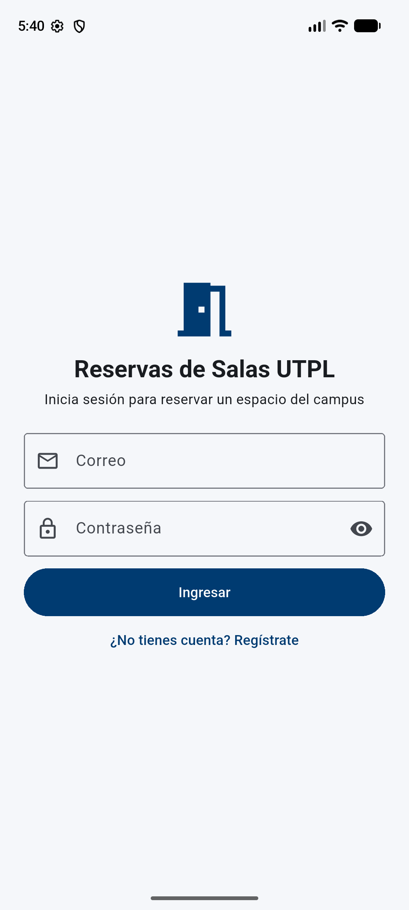
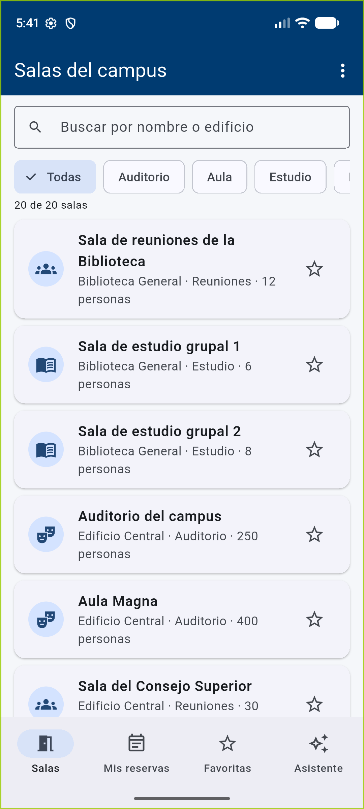
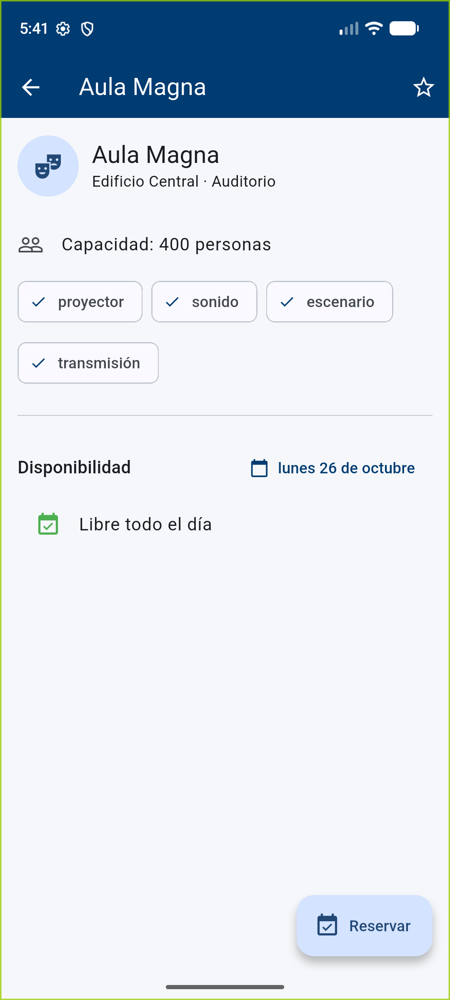
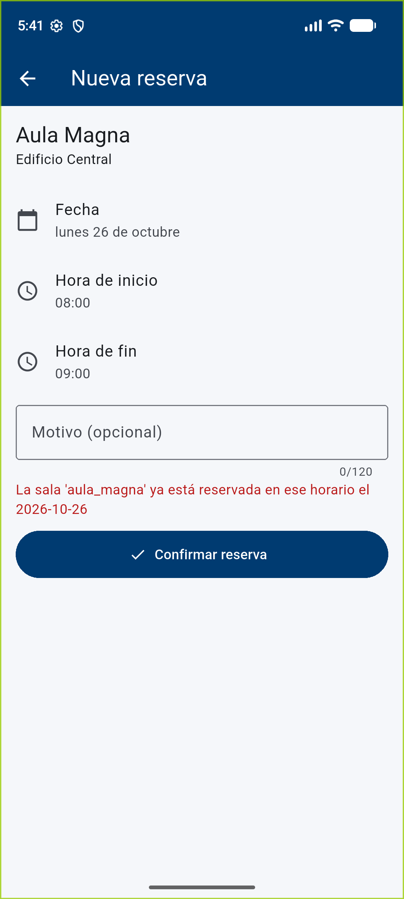
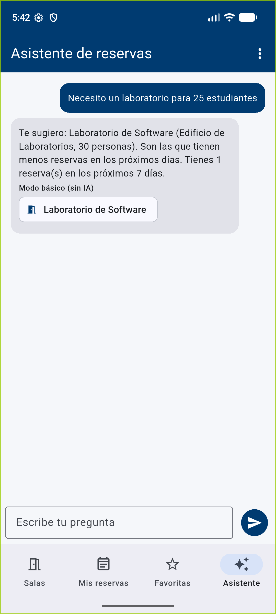

# Reservas de Salas UTPL

App Android (Flutter) para **reservar espacios del campus UTPL**: salas de reuniones, laboratorios, auditorios, aulas y espacios de estudio. Permite ver el catálogo de 20 salas, consultar qué horarios están ocupados en una fecha, reservar y cancelar, guardar salas favoritas y pedir recomendaciones a un asistente de IA. Incluye su propio backend (FastAPI + JWT).

Proyecto Final del curso *Desarrolla Aplicaciones Móviles Robustas con Flutter e IA*.

| Inicio de sesión | Catálogo | Detalle y disponibilidad | Choque de horario (400) | Asistente |
|---|---|---|---|---|
|  |  |  |  |  |

## Qué hace

- **Cuenta:** registro, inicio y cierre de sesión. El token JWT se guarda en almacenamiento seguro y la sesión sobrevive al reinicio.
- **Catálogo (datos reales del backend):** 20 salas con edificio, tipo, capacidad y equipamiento (`GET /salas/`), con búsqueda y filtro por tipo.
- **Disponibilidad compartida:** en el detalle de una sala se ven las franjas ocupadas de la fecha elegida, **de cualquier usuario** (sin decir quién reservó). Si otra persona reserva, el cambio se ve en tu pantalla.
- **Reservas (CRUD remoto con JWT):** crear, ver y cancelar las propias. El backend rechaza horarios que se cruzan, salas inexistentes, horarios invertidos y reservas ajenas.
- **Favoritas (persistencia local):** se guardan en Hive y siguen ahí después de cerrar la app. El catálogo y las reservas también se guardan para verlos sin conexión.
- **Asistente:** recomienda salas según tu pregunta (capacidad, tipo, equipamiento) mirando la ocupación de los próximos 7 días. Responde con **Gemini** cuando el backend tiene una clave; sin clave, responde en **modo básico** (reglas) y lo indica. Nunca reserva por ti.

## Requisitos

- Flutter 3.47 o superior (Dart 3.13) y un emulador Android.
- **Docker Desktop** para el backend; o, sin Docker, Python 3.12 con [uv](https://docs.astral.sh/uv/).
- Opcional: una clave gratuita de Gemini ([Google AI Studio](https://aistudio.google.com/apikey)) para el asistente con IA.

## Cómo ejecutarlo

### 1. Backend

```bash
git clone https://github.com/fovargas/reservas-salas-utpl.git
cd reservas-salas-utpl/backend
cp .env.example .env
```

Edita `backend/.env`:

- `SECRET_KEY`: pon una cadena aleatoria larga. Puedes generarla con `python -c "import secrets; print(secrets.token_hex(32))"`.
- `GEMINI_API_KEY`: opcional. Sin ella, el asistente funciona en modo básico.
- `GEMINI_MODEL`: lista de modelos separados por comas; si uno está saturado o retirado, se usa el siguiente. Deja el valor de `.env.example`.

Levántalo con Docker (crea la base SQLite y aplica las migraciones solo):

```bash
docker compose up --build
```

O sin Docker:

```bash
uv sync
uv run alembic upgrade head
uv run uvicorn app.main:app --host 0.0.0.0 --port 8000
```

Comprueba que responde: `curl http://localhost:8000/salas/` devuelve las 20 salas. La documentación interactiva está en http://localhost:8000/docs.

### 2. App

**Opción A — APK del Release (sin compilar):** descarga `app-release.apk` de la sección [Releases](../../releases) e instálalo en el emulador:

```bash
adb install -r app-release.apk
```

Si antes instalaste una versión de depuración, desinstálala primero: `adb uninstall ec.edu.utpl.reservas_utpl`.

**Opción B — desde el código:**

```bash
cd app
flutter pub get
flutter run
```

Abre la app, toca **¿No tienes cuenta? Regístrate** y crea un usuario (contraseña de 8 caracteres o más).

### Direcciones por entorno

| Entorno | Dirección del backend | Cómo se usa |
|---|---|---|
| Emulador Android (por defecto) | `http://10.0.2.2:8000` | Nada que configurar |
| Teléfono físico en la misma red | `http://<IP-de-tu-PC>:8000` | `flutter run --dart-define=API_BASE_URL=http://<IP>:8000` |
| APK del Release | `http://10.0.2.2:8000` | Se cambia con la variable `API_BASE_URL` del repositorio (Settings → Variables) |

## Pruebas y CI

```bash
cd app && flutter analyze && flutter test          # 18 pruebas, servidor falso
cd backend && uv run ruff check . && uv run pytest  # 68 pruebas
```

`.github/workflows/ci.yml` ejecuta ambas en cada push y pull request. `.github/workflows/release-apk.yml` compila y publica el APK al subir una etiqueta `v*`.

## Arquitectura

```
App (Flutter)                                     Backend (FastAPI)
─────────────                                     ─────────────────
screens/      pantallas, sin HTTP ni Hive         routers/       HTTP ↔ services
   │                                                 │
controllers/  estado GetX (Auth, Salas,           services/      reglas: sala válida, horario,
   │          Reservas, Asistente, Navegación)       │           solapamiento, propiedad, asistente
   ├── services/   ApiClient (dio + JWT) ──HTTP──▶   ├── repositories/  SQLAlchemy (SQLite)
   │               ReservasApi, TokenStorage         ├── ia/gemini.py   cliente de Gemini (clave en .env)
   └── repositories/ AlmacenLocal (Hive)             └── mcp/           mismas reglas expuestas por MCP
```

- Un solo `ApiClient` agrega el token a cada petición y, ante un 401, cierra la sesión en un solo lugar.
- `ApiException` traduce cada error a un mensaje distinto: 400 (motivo del servidor), 401 (credenciales o sesión caducada), 403, 404, 422 (campo inválido), 5xx, tiempo agotado y sin conexión.
- `ReporteErrores` captura los errores no controlados, los registra sin tokens y muestra un aviso en vez de la pantalla roja.

### Decisión técnica: el asistente vive en el backend y tiene un modo básico

**Elegí** poner la IA detrás de `POST /asistente/` en el mismo backend, con la clave de Gemini solo en `backend/.env`. El backend arma el contexto (catálogo y ocupación de 7 días **sin identidades de otros usuarios**), pide a Gemini un JSON y **valida** los ids de sala que devuelve; los que no existen se descartan. Si no hay clave, o Gemini falla o tarda, responde con un recomendador de reglas (capacidad, tipo, menor ocupación) y la app lo indica como «Modo básico».

**Descarté** llamar al proveedor desde la app (la clave quedaría dentro del APK) y un proxy aparte en Node (otro servicio más que levantar para evaluar el proyecto). También descarté que el asistente cree reservas por su cuenta: solo sugiere, y la persona confirma desde el detalle de la sala.

## Seguridad

- **Claves:** solo en `backend/.env`, que está en `.gitignore` y nunca se subió. El repositorio trae `backend/.env.example` sin valores reales. La app no contiene ninguna clave: solo la dirección del backend.
- **Token:** JWT en `flutter_secure_storage` (Keystore en Android), nunca en Hive ni en registros. `ReporteErrores.limpiar()` quita `Bearer …` y JWT de cualquier mensaje.
- **Al cerrar sesión** se borran el token y la copia local de reservas de esa persona.
- **Privacidad:** la ocupación compartida solo dice si una franja es tuya; nunca quién reservó.
- **Auditoría de secretos** (debe no imprimir nada):

  ```bash
  grep -rniE "api[_-]?key\s*[=:]\s*['\"][A-Za-z0-9_-]{8,}|sk-[a-z0-9]{10}|AIza[0-9A-Za-z_-]{20}" app/lib app/test backend/app .github
  git log --all --oneline -- backend/.env .env
  ```

## Agentes de código

El repositorio incluye el arnés de la Sesión 10: `AGENTS.md` (contexto y reglas), `CLAUDE.md` y `.claude/settings.json`. Los permisos dejan analizar y probar, y prohíben leer `backend/.env`, hacer `git push` y crear etiquetas. Un hook formatea cada archivo `.dart` que edite el agente.

## Créditos y licencias

- Backend base: [proyecto-backend-mcp-python](https://github.com/fovargas/proyecto-backend-mcp-python) (Proyecto Integrador MOD2, del mismo autor), ampliado aquí con el catálogo, la ocupación, `/usuarios/me` y el asistente.
- El catálogo de salas es un conjunto propio de ejemplo inspirado en el campus UTPL Loja; nombres y capacidades son ilustrativos.
- Paquetes de la app: [get](https://pub.dev/packages/get) (MIT), [dio](https://pub.dev/packages/dio) (MIT), [flutter_secure_storage](https://pub.dev/packages/flutter_secure_storage) (BSD-3), [hive](https://pub.dev/packages/hive) y [hive_flutter](https://pub.dev/packages/hive_flutter) (Apache-2.0). La lista completa está en la app: menú ⋮ → **Acerca de**.
- Backend: FastAPI (MIT), SQLAlchemy (MIT), Alembic (MIT), PyJWT (MIT), passlib (BSD), httpx (BSD-3), MCP SDK (MIT).
- IA: Google Gemini API, sujeta a sus [términos de uso](https://ai.google.dev/gemini-api/terms).
- Iconos: Material Icons (Apache-2.0).

Autor: Francisco Vargas.
